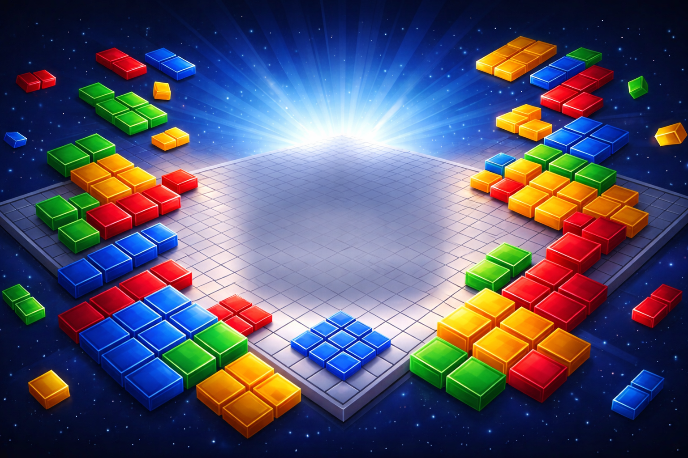
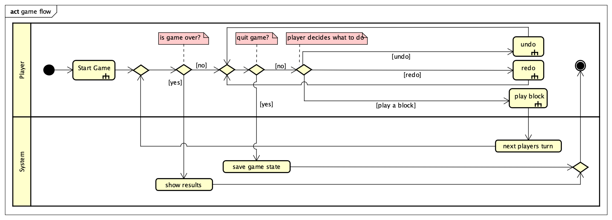
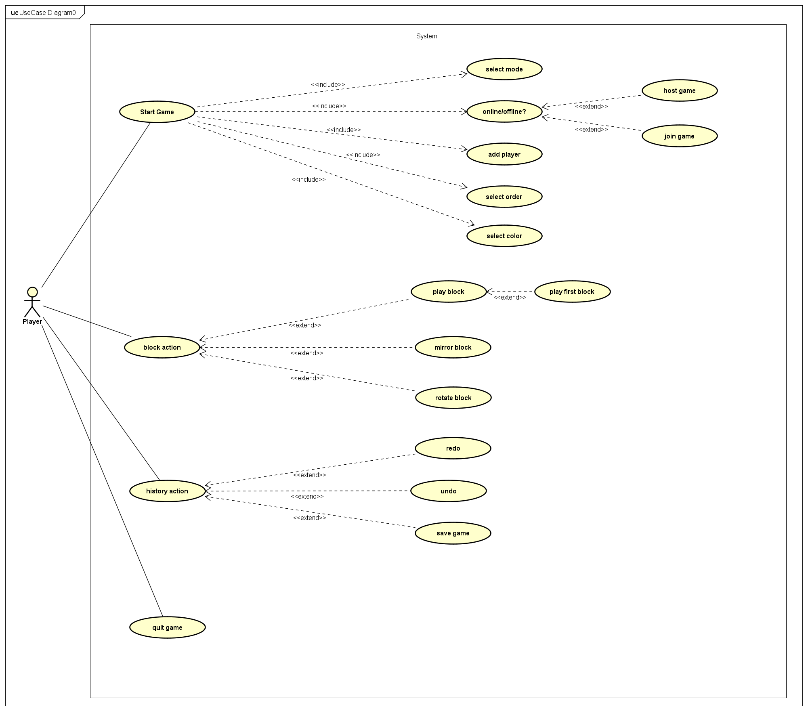
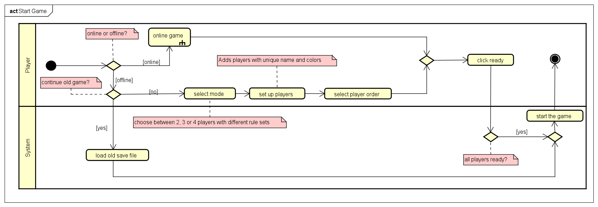
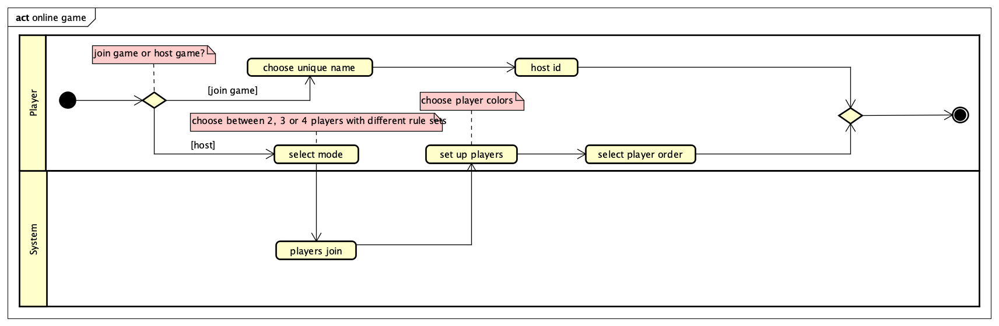
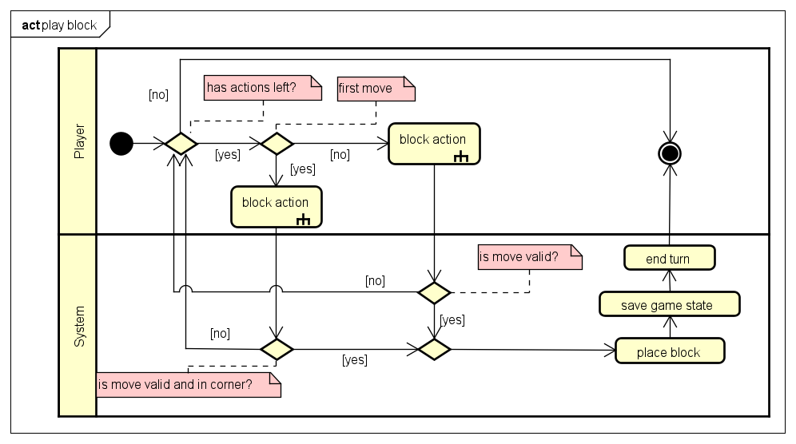
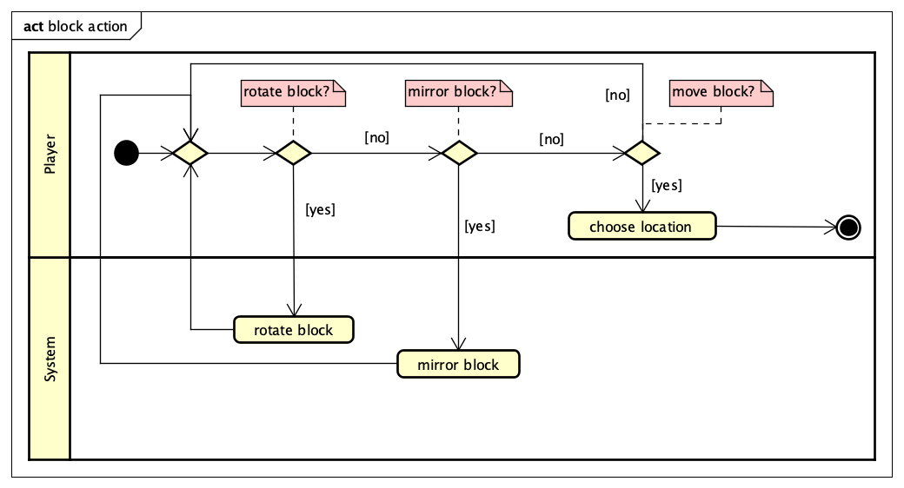
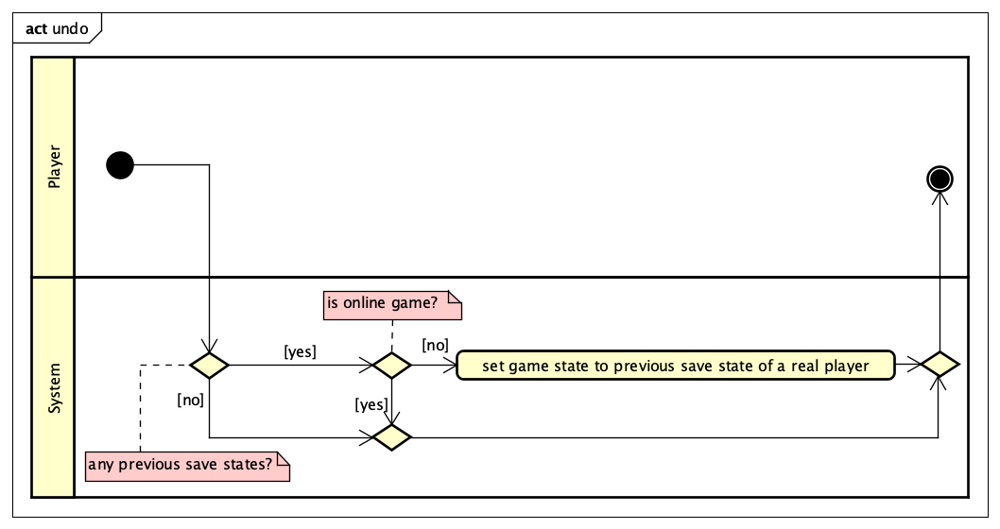
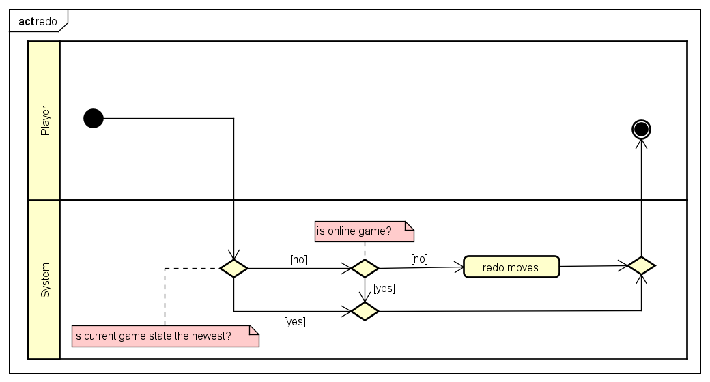
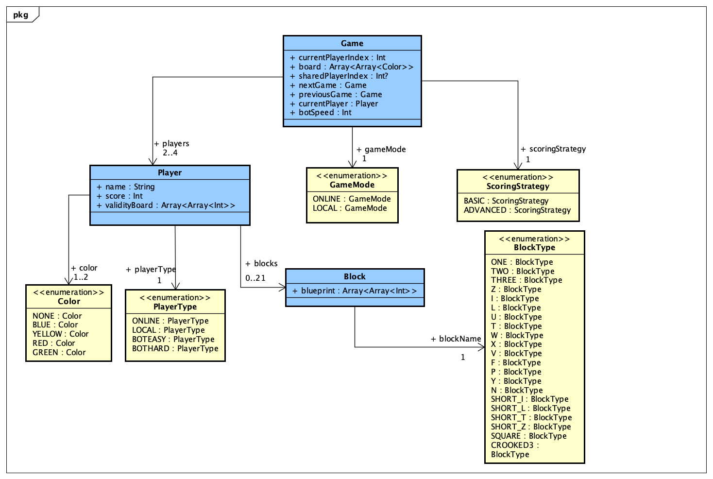

<p align="center">
  
</p>

# Blokus – Software Praktikum Project 2

A desktop implementation of the strategy board game **Blokus** for 2–4 players, written in **Kotlin** with the
**BoardGameWork (BGW)** framework. It supports local hot-seat games, **online multiplayer** over the course's
BGW-Net server, **bots** (easy / hard), **undo / redo** and **save / load**.

> **Course project.** This is the group project (*Gruppenprojekt*) of the **Software Praktikum (SoPra) 2**
> course at **TU Dortmund**, summer term 2026 (SoPra 26A), built by **Group 05** of eight students.
> It builds on the layered architecture and tooling from the first, individual SoPra project
> (see [Push Poker](https://github.com/batuhanbaharr/sopra-push-poker)).

## Features

| Area | What it does |
|------|--------------|
| **Game modes** | 4 players · 3 players (the 4th colour is shared and rotates between the players) · 2 players on the 20×20 board (each controls two colours) · 2 players on a small 14×14 board |
| **Pieces** | All 21 Blokus pieces per colour, with rotation (90° steps) and mirroring |
| **Rules engine** | Validity and blocking boards per colour: first piece in a corner, later pieces touch only diagonally, never along an edge |
| **Scoring** | *Basic*: fewest remaining squares wins. *Advanced*: −1 per remaining square, +15 for placing all pieces, +5 more if the last piece was the single square |
| **Bots** | **Easy** – random valid move. **Hard** – heuristic: prefers large pieces, open corners and moves that restrict opponents |
| **Online play** | Host / join a session over BGW-Net, with a connection state machine and a network message format (NTF) shared by the whole course |
| **History** | Undo / redo through a doubly linked list of game states (local games only) |
| **Save / load** | JSON serialization (kotlinx.serialization) into numbered save slots, including the move history |
| **GUI** | Menu, offline setup, online lobby, game board and ranking scenes in BGW, with custom backgrounds and fonts |

## Architecture

Three layers, as taught in the course. The services never touch the GUI directly; they call
`Refreshable` callbacks (observer pattern) and the GUI scenes update themselves.

| Layer | Package | Contents |
|-------|---------|----------|
| Entity | `entity` | `Game`, `Player`, `Color`, `Block`, and the enums `BlockType`, `ColorType`, `GameMode`, `PlayerType`, `ScoringStrategy`, `Rotation`; `Extensions` converts between entity and network (NTF) types |
| Service | `service` | `RootService` (hub), `GameService` (rules, turns, scoring), `PlayerActionService` (place / rotate / mirror / undo / redo), `SaveService` |
| Service | `service.bot` | `BotService` plus the `BotStrategy` implementations `BotEasy` and `BotHard` |
| Service | `service.network` | `NetworkService` (host / join / send & receive actions), `GameNetworkClient` (BGW client), `ConnectionState` |
| GUI | `gui` | `GameApplication` and the scenes: main menu, offline setup, online menu and lobby, game board, save menu, ranking |

### Game and rules overview





### Starting a game





### Playing a piece





### Undo and redo

| Undo | Redo |
|------|------|
|  |  |

### Entity model



*This is the early design draft. The implementation evolved: for example `BlockType` now uses names such as
`I5`, `L5`, `O1`, and `Color` became its own class that owns the pieces, validity board and blocking board of a colour.
See the KDoc in `src/main/kotlin/entity` for the current model.*

## How the game logic works

- **Validity & blocking boards.** After every turn `GameService` rebuilds two boards per colour. The *validity
  board* marks the diagonal corners where that colour may attach; the *blocking board* marks occupied cells and the
  cells next to the colour's own pieces. `PlayerActionService.isValidBlockPlacement` checks a piece against both.
- **Turn order.** `endTurn` finds the next colour that still has a legal move (`hasValidTurnLeft` tries every
  piece × rotation × mirror × corner). When no colour can move any more, `endGame` computes the ranking.
- **Undo / redo.** Every finished turn is stored as a `Game` copy linked through `previousGame` / `nextGame`.
  Undo jumps back to the previous state in which a *local* human was to move, so bot and online turns are skipped.
- **Persistence.** `SaveService` serializes the chain of states to `SaveFile_<slot>.json` in the working directory.

## Testing

About **80 unit tests** (JUnit 5 via `kotlin-test`) cover the service layer: starting games in every mode, ending
turns and the game, scoring and ranking, valid-move detection, block placement, rotation and mirroring, undo / redo,
saving and loading (including an empty save file) and the network service.
The entity, bot and GUI packages are excluded from the coverage report by the course tooling.

## Build and run

Requirements: **JDK 11 or newer**.

```bash
./gradlew run      # start the game
./gradlew test     # run the unit tests
./gradlew detekt   # static code analysis
```

> **Note:** the build uses the course's `edu.udo.cs.sopra` Gradle plugin and the `ntf` network-format library from
> the TU Dortmund GitLab package registry. A full build therefore needs course access (a registry token supplied
> through the `sopra-gitlab.package-registry.token` Gradle property). Online games additionally need the course's
> BGW-Net server. Local, bot and save/load games work without a network connection.

## Project layout

```
src/main/kotlin
├── Main.kt
├── entity/            Game, Player, Color, Block and enums
├── service/           GameService, PlayerActionService, SaveService, RootService
│   ├── bot/           BotService, BotEasy, BotHard
│   └── network/       NetworkService, GameNetworkClient, ConnectionState
└── gui/               BGW scenes
src/main/resources     backgrounds and fonts
src/test/kotlin        unit tests (service layer)
docs/diagrams          UML activity, use-case and entity diagrams
```

## Team

Developed by Group 05, a team of eight students, as part of the SoPra 2 course.

*Blokus is a trademark of Mattel. This is a non-commercial university project and is not affiliated with Mattel.*
